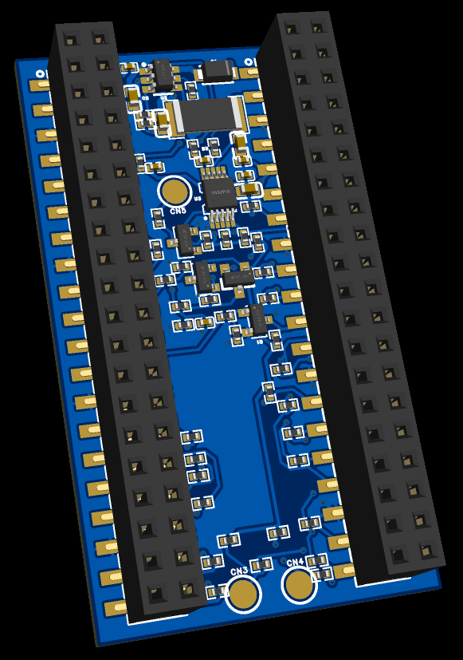
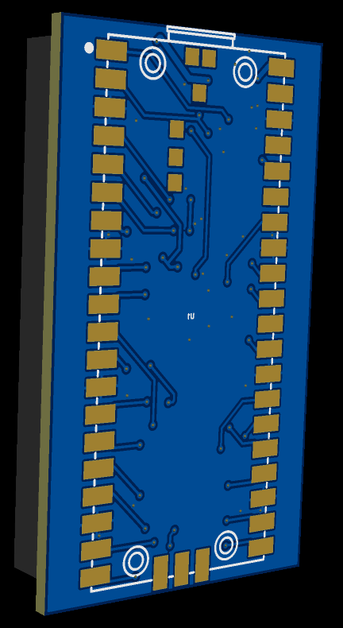

# PicoHarness

<p align="center"><a href="README.md">English</a> · <strong><a href="README.zh-CN.md">简体中文</a></strong></p>

<p align="center">
  
  
</p>

PicoHarness 是围绕双 Pico 载板的一套调试与测量工具。Debug Core 是一颗
CMSIS-DAP 探针，同时通过 TPS22919 门控开关 Work Pico 的电源、控制其
RUN/BOOTSEL，并用 INA237/INA226 采样分流支路读取电压、电流与功率。SWD、
UART、SPI、GPIO 采样、电源和固件烧录都通过 USB 上的同一个二进制协议
（PDBG Link）暴露出来，因此这套硬件既可以由桌面程序驱动，也可以直接交给
脚本或 AI 代理使用。

一条 USB 连接就能提供：

- **CMSIS-DAP v2** —— 对 Work Core 的 SWD 调试：暂停/恢复、寄存器、GDB、
  内存读写与导出。
- **电源控制与测量** —— 开关 Work 电源支路，读取实时的电压、电流与功率。
- **Console** —— 到 Work Core 的 UART 双向通道；配合通信库时大块数据自动
  改走 SPI/DMA。
- **逻辑分析** —— 外设运行期间被动采样 GPIO，支持 UART、SPI、I²C、PWM
  解码器。
- **固件上传** —— 通过 SWD 烧写 Work Core，或通过 USB 升级 Debug Core
  自身。

通信走 PDBG Link vendor bulk 协议：小端序、CRC 校验帧，承载 UART、SPI、
电源与逻辑分析命令。

## 目录结构

| 路径 | 内容 |
| --- | --- |
| `desktop/` | Rust/egui 桌面程序（总览、Console、SWD/GDB、逻辑分析、固件）与 USB 控制库 |
| `firmware/harness-probe/` | Debug Core 固件：CMSIS-DAP、PDBG Link、UART/SPI、GPIO 采样、电源与测量 |
| `firmware/harness-target/` | 可导入的 CMake 通信库及 Work Pico 示例 |
| `firmware/test/` | 独立测试固件：blink、普通 UART、带宽测试、Work 自检 |
| `host/` · `script/` | Python CLI（`pdbg`）与构建/检查入口 |
| `pcb/pico-dualcore-devboard-v1.2/` | 载板：EasyEDA 工程 |
| `doc/` | 架构、协议、硬件与制造说明 |
| `third_party/` | 保留原始许可证的第三方组件 |

## 构建

前置依赖：官方 Pico SDK（`PICO_SDK_PATH`）、CMake、Ninja、
arm-none-eabi-gcc，以及用于桌面端的 Rust。Debug Core 升级需要 `picotool`；
SWD/GDB 与 Work 烧写需要 OpenOCD。

```sh
git submodule update --init --recursive
export PICO_SDK_PATH=/path/to/pico-sdk

./build.sh build            # Debug Core UF2 -> RELEASE/artifacts/
./build.sh test --offline   # 主机、协议与板级离线检查
cargo test --manifest-path desktop/Cargo.toml --workspace

cargo run --manifest-path desktop/Cargo.toml -p picoharness-desktop
```

`./build.sh flash` 升级 Debug Core；`./build.sh test --hardware` 会覆盖 Work
Flash 并运行自检，请先备份。多探针时用 `PDBG_SERIAL` 或在桌面端设备侧栏选择。

更多内容见[桌面端说明](desktop/README.md)、[Work 侧入门](firmware/harness-target/GETTING_STARTED.md)
与 [Work 通信库](firmware/harness-target/README.md)。

## 许可

项目代码大部分为 MIT。Debug Core 固件为组合构建，其中的逻辑分析器衍生自
[gusmanb 的 LogicAnalyzer](https://github.com/gusmanb/LogicAnalyzer)
（仅 GPL-3.0），因此包含它的固件按 GPL-3.0-only 分发；桌面端与 Work 通信库
为 MIT。第三方声明见 [THIRD_PARTY_NOTICES.md](THIRD_PARTY_NOTICES.md)。